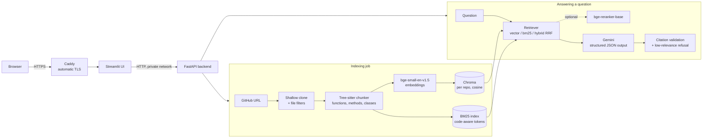

# Codebase Q&A

Ask questions about a GitHub repository in plain English, such as *"Where is authentication handled?"* or
*"What happens when a password reset token is invalid?"*, and get an answer that cites the exact files and line ranges,
with the cited code shown and linked to GitHub at the indexed commit.

**Live demo:** <https://codebase-qa-avinash.indiasouthcentral.cloudapp.azure.com>. Paste a link to any public GitHub
repository (or click "Try a sample repository"), wait for it to be indexed, then ask questions about it. No sign-up or
password needed. Repositories you add are private to your browser link and are deleted 24 hours after you last use them. It runs on a
single Azure VM with Docker Compose and Caddy; see [DEPLOY.md](DEPLOY.md).

## What it does

- **Index any public GitHub repo** from its URL: shallow clone, skip vendored and build-output directories, lockfiles,
  minified, binary and oversized files, split code into function- and class-level chunks with tree-sitter, embed them,
  and store them in Chroma plus a BM25 keyword index. Indexing runs as a background job with progress.
- **Answer questions with grounded citations:** retrieve the most relevant chunks, ask Gemini for a structured JSON
  answer, and keep only citations that point inside the code actually given to the model. Questions the repository
  clearly cannot answer are refused without calling the LLM.
- **Re-index incrementally:** pull the latest commit, diff it against the indexed commit, and re-embed only the
  changed files (7.2x faster than a full rebuild on the test repo, with identical results).
- **Measured, not guessed:** every retrieval change was evaluated on 35 development questions with known answer
  locations; 15 held-out questions were only used once, at the end.

## Architecture



Chunkers, embedders, retrievers, rerankers and generators are `Protocol` interfaces
([`interfaces.py`](backend/src/codebase_qa/interfaces.py)), so the evaluation harness can swap them and compare results.

## Results

Test repository: [fastapi/full-stack-fastapi-template](https://github.com/fastapi/full-stack-fastapi-template) at
`7257e606` (212 indexed files, Python backend and React/TypeScript frontend). 50 questions in four categories
(where-is, how-does, what-happens-when, config), each with expected `path:start-end` locations: 35 for development,
15 held out. A retrieved chunk is a hit when its line range overlaps an expected location.

**Development set (35 questions)**

| Configuration | Hit@1 | Hit@5 | Recall@10 | MRR | Citation precision | Answers with a correct citation | Retrieval latency |
|---|---|---|---|---|---|---|---|
| Baseline: 40-line chunks + vector search | 0.457 | 0.629 | 0.729 | 0.543 | 0.548 | 0.629 | 45 ms |
| Tree-sitter chunks + vector search | **0.571** | 0.714 | 0.767 | **0.651** | 0.648 | 0.771 | 46 ms |
| Tree-sitter + hybrid (vector + BM25, RRF) | 0.371 | 0.686 | 0.795 | 0.500 | - | - | 54 ms |
| Tree-sitter + hybrid + reranker | 0.314 | 0.657 | 0.748 | 0.471 | - | - | 16.6 s |
| Tree-sitter + hybrid + reranker fused with first stage | 0.400 | **0.743** | **0.838** | 0.544 | - | - | 18.6 s |
| **Final:** tree-sitter + vector + grounded generation | **0.571** | 0.714 | 0.767 | **0.651** | **0.714** | **0.771** | 46 ms (+2.3 s generation) |

**Held-out set (15 questions, run once at the end)**

| Configuration | Hit@1 | Hit@5 | Recall@10 | MRR | Citation precision | Answers with a correct citation |
|---|---|---|---|---|---|---|
| Baseline: 40-line chunks + vector search | 0.200 | 0.667 | 0.700 | 0.364 | 0.633 | 0.733 |
| Final: tree-sitter + vector + grounded generation | **0.533** | **0.733** | **0.800** | **0.613** | 0.633 | 0.733 |

How to read this:
- **Tree-sitter chunking is the biggest win.** Chunks that follow function and class boundaries, with the class name
  and signature in a header, put the right code first far more often: Hit@1 rises from 0.457 to 0.571 on the dev
  set and from 0.200 to 0.533 on the held-out set.
- **Grounding raises citation precision** from 0.648 to 0.714 on the dev set by dropping citations outside the
  retrieved code. On the held-out set, both runs use the grounded generator and score the same 0.633; with 15
  questions, per-question gains and losses cancel out.
- **Hybrid search and reranking help recall, not ranking.** BM25 finds exact tokens that embeddings blur (`401`,
  `CORSMiddleware`, `toast`), but it also ranks generated API clients and tests highly; with equal-weight RRF that noise
  pushes correct answers down. The general-purpose cross-encoder prefers prose and descriptively named tests over
  implementations, and costs about 17 s per question on CPU. Both stay optional; details and 5 wins / 5 losses are in
  [eval/analysis.md](eval/analysis.md).
- All answer-level runs use `gemini-3.5-flash-lite` at temperature 0 with an on-disk response cache.

**Incremental re-indexing benchmark** ([eval/benchmarks](eval/benchmarks)): moving the test repo forward 10 upstream
commits (`3ecbabf7` to `7257e606`) changed 15 files.

| | Time | Notes |
|---|---|---|
| Full rebuild (212 files, 1,087 chunks) | 122.1 s | |
| Incremental re-index (git diff, 15 files) | **17.0 s (7.2x faster)** | 81 chunks added, 80 removed; 14.2 s of it is embedding |
| Result | identical | same chunk ids, BM25 corpus and file registry as the full rebuild |

### Improvement log (v2)

Each change below was measured on the 35 development questions before and after, with the same index and
`gemini-3.5-flash-lite`. Retrieval metrics come from the pipeline's retrieval stage; citation metrics from grounded
answers.

| Step | Change | Hit@1 | Hit@5 | Recall@10 | MRR | Citation precision | Notes |
|---|---|---|---|---|---|---|---|
| 0 | Starting point (tree-sitter + vector + grounded generation) | 0.571 | 0.714 | 0.767 | 0.651 | 0.714 | reproduced from the table above |
| 1 | Index-time repository overview (tree, README, LLM summaries) | 0.571 | 0.714 | 0.767 | 0.651 | 0.729 | overview stored separately, not used by code retrieval yet; 31 overview chunks from 5 LLM calls; citation change is LLM run-to-run noise after a cache-key change |

## Running it locally

Requirements: Python 3.11 ([uv](https://docs.astral.sh/uv/) recommended), git, and a Google AI Studio API key for
answer generation (indexing, retrieval and tests work without one).

```bash
uv venv --python 3.11 .venv
```
```bash
uv pip install --index-strategy unsafe-best-match --extra-index-url https://download.pytorch.org/whl/cpu -e ".[dev,frontend]"
```

Create `.env` from `.env.example` and set at least `GEMINI_API_KEY` (and optionally `DEMO_PASSWORD`, `DEMO_REPO_URL`).

Start the backend and the UI in two terminals (Windows paths shown; use `.venv/bin/` on Linux and macOS):

```bash
.venv/Scripts/python -m uvicorn codebase_qa.api.app:app --port 8000
```
```bash
.venv/Scripts/python -m streamlit run frontend/app.py
```

Open <http://localhost:8501>, index a repository from the sidebar, and ask questions. The first indexing run downloads
the embedding model (about 130 MB).

Tests and lint (123 tests; no network and no API key needed):

```bash
.venv/Scripts/python -m pytest
```
```bash
.venv/Scripts/python -m ruff check .
```

Evaluation:

```bash
.venv/Scripts/python -m eval.run --config my-run --chunker treesitter --mode vector --answers
```
```bash
.venv/Scripts/python -m eval.compare --split dev
```

Other tools: `eval.calibrate` (refusal threshold), `eval.benchmark_reindex` (incremental vs full), `eval.review`
(renders questions with their expected code for manual checking).

## API

| Method and path | Purpose |
|---|---|
| `GET /health` | Status, number of repos, active jobs, visitor limits, whether re-indexing needs the owner password |
| `POST /repos` `{"url"}` | Validate a GitHub URL and add it for this visitor: reuses an existing index instantly, otherwise starts an indexing job (202 + job) |
| `GET /repos` | Repositories visible to this visitor (the demo repo plus their own) with commit, file and chunk counts |
| `POST /repos/{id}/reindex` | Start an incremental re-index job; its result is the change report |
| `GET /jobs/{id}` | Job status, progress text, result or error |
| `POST /ask` `{"repo_id", "question"}` | Answer, validated citations with code snippets, retrieved chunks with scores, per-stage latency |

No sign-up: the UI sends a random visitor id (`X-Visitor-Id`, kept in the page URL) that scopes which repositories a
visitor sees. Each visitor can add 5 repositories per day and ask 30 questions per day (10 per minute); daily limits
count per IP so a new link does not reset them. Visitor repositories are deleted 24 hours after their last use, at most
15 are stored (oldest removed first). The sample repository is pre-indexed and never deleted, so adding it is instant,
but like every repository it only appears for visitors who add it. Only `POST /repos/{id}/reindex` needs the
owner password (`X-Demo-Password`). An optional site-wide daily question cap (`ASK_DAILY_LIMIT`) is off by default.

## Design decisions

| Choice | Why | Trade-off |
|---|---|---|
| **Tree-sitter chunking** (`tree-sitter-language-pack`, Python, JS, TS/TSX, Go, Java) | Chunks match how developers think (one function, method or class) and carry a header with the file, class and signature; exact line numbers make citations trustworthy | Per-language node rules to maintain; other files fall back to 40-line windows. Version 1.21 crashed on Windows and downloads grammars at runtime, so 0.13.0 (grammars bundled) is pinned |
| **bge-small-en-v1.5, embeddings computed by the app** | Small (384 dimensions, ~130 MB), fast on CPU, strong for its size; computing embeddings ourselves keeps query and document encoding identical and the model swappable | A larger or code-specific model would likely retrieve better but needs more RAM or a GPU |
| **Chroma PersistentClient, one collection per repo and chunker** | Embedded, no separate server, cosine distance and metadata filters (delete by path for incremental re-indexing) | Single-node only; fine for a handful of repos |
| **bm25s with a code-aware tokenizer** | Fast sparse search; keeps whole identifiers and also splits `camelCase`/`snake_case`, so `get_password_hash` matches "password hash" | Measured: hurts Hit@1 here because tests and generated code repeat identifiers; kept as an option |
| **Reciprocal rank fusion (k=60)** | Parameter-free way to merge rankings with incompatible scores | Equal votes let a weak retriever outvote a strong one; weighted fusion is a natural next step |
| **bge-reranker-base (optional)** | Standard cross-encoder reranking over the fused top 30 | Measured: worse ranking on code and ~17 s per question on CPU, so off by default; a code-trained reranker is the follow-up |
| **Gemini with JSON schema output + citation validation** | Free tier; structured output makes citations machine-checkable; citations outside the given context are dropped and counted | Free-tier quotas are per model and per day (20/day on the larger model), so evaluation uses the lite model and an on-disk cache |
| **Low-relevance refusal (cosine < 0.60)** | Saves LLM calls and avoids confident answers about code that does not exist; calibrated on dev vs off-topic questions (0/35 dev refused, 5/12 off-topic refused) | Similarity distributions overlap, so the prompt's "I don't know" rule handles the rest |
| **Incremental re-index via `git diff`, hash fallback** | Re-embeds only changed files; renames and deletions handled; tested equal to a full rebuild | A shallow clone needs both commits' trees; when the old commit is unknown, it falls back to comparing content hashes |
| **FastAPI backend, Streamlit frontend over HTTP only** | Clear API boundary, testable backend, quick UI; the frontend never touches indexes directly | Streamlit reruns the script on each interaction; fine for a demo UI |
| **Single-worker background jobs, JSON registry** | No extra infrastructure; serializing indexing avoids concurrent writes | Jobs live in memory and are lost on restart; a queue and a database would be needed at scale |
| **Docker Compose + Caddy on one Azure VM** | Free with student credit, automatic HTTPS on a free `cloudapp.azure.com` name, models baked into the image | One machine, no autoscaling; Hugging Face Spaces was the first plan but Docker Spaces now need a paid plan |
| **Open demo with private per-visitor repositories** | A password or sign-up would stop most reviewers; anyone can try their own repository. A random visitor id in the URL keeps each visitor's repositories private; identical repositories are indexed once and shared behind the scenes; 24-hour expiry and a 15-repository cap bound disk use | Limits are per IP, so a VPN gets a fresh allowance; indexing runs one job at a time, so busy periods mean waiting; when the free Gemini quota runs out the demo asks visitors to come back tomorrow |
| **Hardening** | GitHub-only URLs, 200 MB size check, no hooks/symlinks/LFS when cloning, repo code never executed, rate limits, no stack traces in responses | Rate limits are in memory per process |

## Limitations

- The 50 evaluation questions and their expected locations were written while building the system, from reading the
  test repository; they were not independently verified by a second person.
- One test repository and 15 held-out questions: a single question moves held-out metrics by 0.067.
- Retrieval quality is limited by a small general-purpose embedding model; reranking with a general-purpose
  cross-encoder did not help on code.

## Project layout

```
backend/src/codebase_qa/   ingestion, chunking, embedding, retrieval, generation, indexing, api
frontend/                  Streamlit app (HTTP client, code viewer)
tests/                     pytest suite with temp-dir git fixture repos and fake models
eval/                      questions, harness, results/*.json, benchmarks/, analysis.md
Dockerfile, docker-compose.yml, deploy/Caddyfile, DEPLOY.md
.github/workflows/         CI (lint, tests, image build) and a manual eval workflow
```
