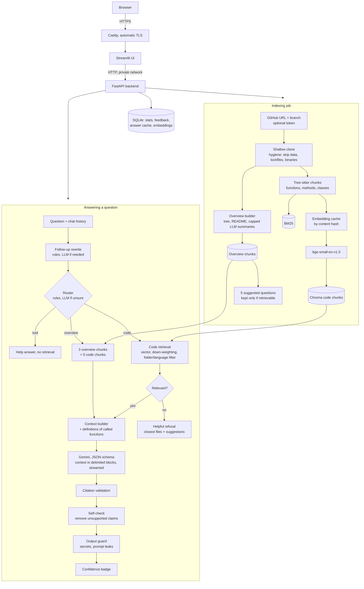
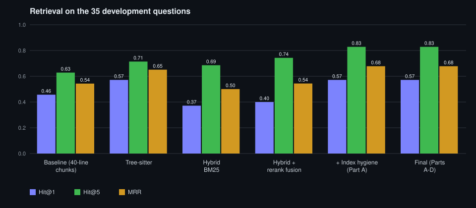

# Codebase Q&A

Ask questions about a GitHub repository in plain English, such as *"Where is authentication handled?"* or
*"What happens when a password reset token is invalid?"*, and get an answer that cites the exact files and line ranges,
with the cited code shown and linked to GitHub at the indexed commit.

**Live demo:** <https://codebase-qa-avinash.indiasouthcentral.cloudapp.azure.com>. Paste a link to any public GitHub
repository (or click "Try a sample repository"), wait for it to be indexed, then ask questions about it. No sign-up or
password needed. Repositories you add are private to your browser link and are deleted 24 hours after you last use
them. It runs on a single Azure VM with Docker Compose and Caddy; see [DEPLOY.md](DEPLOY.md).

## What it does

- **Index any GitHub repo** from its URL, any branch, public or private (with a token you supply for that request
  only): shallow clone, skip vendored, generated-data and binary files, split code into function- and class-level
  chunks with tree-sitter, embed them, and store them in Chroma plus a BM25 index. Indexing also builds a
  **repository overview** (folder tree, README, one-line LLM summaries of important files and folders) and
  **5 suggested questions** that are verified to be answerable.
- **Answer with grounded citations:** follow-up questions are rewritten into standalone ones, each question is routed
  (about the tool, about the repository as a whole, or about specific code), the right context is retrieved
  (down-weighting tests and generated code, optionally restricted to a folder or language), definitions of called
  functions are added, and Gemini writes a structured answer. Citations outside the given code are dropped, a
  self-check removes claims the cited code does not support, and a high / medium / low confidence badge is shown.
  Answers stream to the UI as they are written.
- **Fail helpfully:** questions the repository cannot answer get the closest files and suggested questions instead of
  a flat "I don't know"; if the LLM is rate-limited, out of quota or down, the best-matching code locations are shown.
- **Production basics:** per-question latency, token and cost logging with a stats page, embedding and answer caches,
  retries with backoff, prompt-injection defenses, thumbs up/down feedback with JSONL export, incremental re-indexing,
  rate limits and per-visitor privacy.
- **Measured, not guessed:** every change was evaluated on development questions with known answer locations before
  it was kept; 15 held-out questions were only used at the end.

## Architecture



Chunkers, embedders, retrievers, rerankers, generators and the LLM are `Protocol` interfaces
([`interfaces.py`](backend/src/codebase_qa/interfaces.py)), so the evaluation harness can swap them and compare results.

## Results

Test repository: [fastapi/full-stack-fastapi-template](https://github.com/fastapi/full-stack-fastapi-template) at
`7257e606` (212 indexed files, Python backend and React/TypeScript frontend). 65 questions: 35 development and 15
held-out questions in four categories (where-is, how-does, what-happens-when, config), each with expected
`path:start-end` locations, plus 10 overview and 5 unanswerable development questions. A retrieved chunk is a hit when
its line range overlaps an expected location.



### Final results

**Retrieval and citations, development set (35 questions)**

| Configuration | Hit@1 | Hit@5 | Recall@10 | MRR | Citation precision | Answers with a correct citation | Retrieval latency |
|---|---|---|---|---|---|---|---|
| Baseline: 40-line chunks + vector search | 0.457 | 0.629 | 0.729 | 0.543 | 0.548 | 0.629 | 45 ms |
| Tree-sitter chunks + vector search | 0.571 | 0.714 | 0.767 | 0.651 | 0.648 | 0.771 | 46 ms |
| Tree-sitter + hybrid (vector + BM25, RRF) | 0.371 | 0.686 | 0.795 | 0.500 | - | - | 54 ms |
| Tree-sitter + hybrid + reranker | 0.314 | 0.657 | 0.748 | 0.471 | - | - | 16.6 s |
| Tree-sitter + hybrid + reranker fused with first stage | 0.400 | 0.743 | **0.838** | 0.544 | - | - | 18.6 s |
| v1 final: tree-sitter + vector + grounded generation | 0.571 | 0.714 | 0.767 | 0.651 | 0.714 | 0.771 | 46 ms |
| **Final (v2): + index hygiene, call context, self-check, delimited prompts** | 0.571 | **0.829** | 0.805 | **0.678** | **0.743**\* | **0.829**\* | 78 ms |

\* Measured with `gemini-3.5-flash-lite` before the prompt-injection delimiters were added (step 9). After them, on the
32 questions answered before the free quota ran out, citation precision rose from 0.732 to 0.818 with an equal share of
answers with a correct citation (0.906), using `gemini-3.1-flash-lite` for both runs (step 17).

**Held-out set (15 questions, used only here)**

| Configuration | Hit@1 | Hit@5 | Recall@10 | MRR | Citation precision | Answers with a correct citation |
|---|---|---|---|---|---|---|
| Baseline: 40-line chunks + vector search | 0.200 | 0.667 | 0.700 | 0.364 | 0.633 (v1 run) | 0.733 (v1 run) |
| v1 final: tree-sitter + vector + grounded generation | 0.533 | 0.733 | 0.800 | 0.613 | 0.633 | 0.733 |
| **Final (v2)** | **0.533** | **0.800** | **0.800** | **0.619** | pending\*\* | pending\*\* |

\*\* Answer-level held-out runs for v2 are pending: every free Gemini model available to this key hit its daily quota
on the day of the final evaluation. Retrieval metrics need no LLM and are final.

**Answer quality by part** (50 dev questions: 35 code + 10 overview + 5 unanswerable; `gemini-3.1-flash-lite` as
generator and judge). Refusal accuracy: refuse exactly the unanswerable questions. Faithfulness (1-5, answers that were
not refusals) and relevance (1-5, answerable questions) are graded by an LLM judge with a fixed rubric
([eval/judge.py](eval/judge.py)).

| Configuration | Hit@1 | Hit@5 | Recall@10 | MRR | Citation precision | Answers with a correct citation | Refusal accuracy | Faithfulness | Relevance |
|---|---|---|---|---|---|---|---|---|---|
| Before Part A (v2 features off) | 0.571 | 0.714 | 0.767 | 0.651 | 0.700 | 0.771 | 0.96 | 4.93 | 4.84 |
| After Part A (overview, routing, refusals, hygiene, follow-ups) | 0.571 | **0.829** | **0.805** | **0.678** | 0.710 | 0.829 | 0.94 | 4.95 | 4.89 |
| After Part B (+ call context, self-check; expansion and parent context off) | 0.571 | **0.829** | **0.805** | **0.678** | 0.698 | **0.857** | 0.94 | **4.98** | **4.98** |

The lite judge is lenient, so faithfulness sits near the ceiling; relevance and refusal accuracy move more. Part A's
refusal accuracy dips because one more answerable question gets a "not found" answer; Part B's self-check removed
unsupported claims from 5 of 45 cited answers. On `gemini-3.5-flash-lite`, the first two rows were 0.92 / 4.98 / 4.73
and 0.92 / 5.00 / 4.67 (refusal accuracy / faithfulness / relevance).

**Second repository:** [AnishAwadh/StudyNotion](https://github.com/AnishAwadh/StudyNotion) (MERN, JavaScript/JSX,
commit `4279c14e`), 20 questions (16 with expected locations, 2 overview, 2 unanswerable) in
[eval/questions_studynotion.jsonl](eval/questions_studynotion.jsonl). **These questions were written and selected by
the author of this project and were not independently verified.**

| Configuration | Hit@1 | Hit@5 | Recall@10 | MRR | Citation precision | Answers with a correct citation | Refusal accuracy | Faithfulness | Relevance |
|---|---|---|---|---|---|---|---|---|---|
| Baseline: 40-line chunks + vector, v2 features off | 0.375 | 0.875 | 0.969 | 0.610 | 0.750 | 0.875 | 1.00 | 5.00 | 4.89 |
| Final (v2) | **0.688** | **0.938** | 0.969 | **0.794** | 0.740 | **0.938** | 1.00 | 5.00 | **5.00** |

**Load test** ([loadtest/](loadtest), [eval/benchmarks](eval/benchmarks)): one uvicorn process on the development laptop
(Windows, 16 logical CPUs), real bge-small embeddings on CPU and Chroma search for every request, LLM mocked (instant),
answer and embedding caches off, random dev questions, 45 s per level. The pipeline is CPU-bound on query embedding,
so throughput is flat and latency grows with concurrency; the 2-vCPU VM will be slower, and real Gemini calls add
2-5 s per question (I/O wait, not CPU).

| Concurrent users | Requests/s | Median | p95 | Failures |
|---|---|---|---|---|
| 5 | 13.3 | 0.28 s | 0.54 s | 0 |
| 10 | 13.2 | 0.63 s | 1.2 s | 0 |
| 20 | 11.6 | 1.6 s | 2.8 s | 0 |

**Incremental re-indexing** ([eval/benchmarks](eval/benchmarks)): moving the test repo forward 10 upstream commits
(`3ecbabf7` to `7257e606`) changed 15 files.

| | Time | Notes |
|---|---|---|
| Full rebuild (212 files, 1,087 chunks) | 122.1 s | |
| Incremental re-index (git diff, 15 files) | **17.0 s (7.2x faster)** | 81 chunks added, 80 removed; 14.2 s of it is embedding |
| Full rebuild with a warm embedding cache | **6.8 s** | all 1,087 embeddings reused (134.4 s cold in the same run) |
| Result | identical | same chunk ids, BM25 corpus and file registry as the full rebuild |

How to read this:
- **Tree-sitter chunking is the biggest single win** (Hit@1 0.457 -> 0.571 dev, 0.200 -> 0.533 held-out).
- **Index hygiene is the biggest v2 win.** Tests repeat the names of the code they test and generated API clients
  repeat every endpoint; down-weighting them at query time lifts Hit@5 from 0.714 to 0.829 on dev and from 0.733 to
  0.800 on held-out. The eval has no question that targets tests, so this choice favours implementation questions.
- **Hybrid search, reranking and LLM query expansion did not pay off** on this repo: each improved one metric and hurt
  another, and the reranker and expansion add seconds per question. They stay available as flags. Details in
  [eval/analysis.md](eval/analysis.md) and the step log below.
- **Most v2 features improve the experience rather than retrieval:** follow-up rewriting (Hit@1 0.125 -> 0.500 on
  follow-ups), helpful refusals, a calibrated confidence badge, streaming, filters, caching and failure handling.

### Improvement log (v2)

Each change was measured on the 35 development questions before and after, with the same index and
`gemini-3.5-flash-lite` (steps 0-11). Retrieval metrics come from the pipeline's retrieval stage; citation metrics from
grounded answers. A change that dropped any retrieval metric by more than 2 points was fixed or turned off.

| Step | Change | Hit@1 | Hit@5 | Recall@10 | MRR | Citation precision | Notes |
|---|---|---|---|---|---|---|---|
| 0 | Starting point (tree-sitter + vector + grounded generation) | 0.571 | 0.714 | 0.767 | 0.651 | 0.714 | reproduced from the v1 final row |
| 1 | Index-time repository overview (tree, README, LLM summaries) | 0.571 | 0.714 | 0.767 | 0.651 | 0.729 | overview stored separately, not used by code retrieval; 31 overview chunks from 5 LLM calls; citation change is LLM run-to-run noise after a cache-key change |
| 2 | Question routing (tool / overview / code; rules first, LLM only when unsure) | 0.571 | 0.714 | 0.767 | 0.651 | 0.729 | all 35 dev questions routed to code by rules (0 extra LLM calls, 0.4 ms); tool questions skip retrieval; overview questions get 3 overview chunks + 5 code chunks |
| 3 | Helpful refusals + 5 suggested questions per repo | 0.571 | 0.714 | 0.767 | 0.651 | 0.729 | refusals list the closest files and 3 suggested questions; the 3 dev answers where the LLM said "I don't know" (all retrieval misses) are now reported as refusals; suggestions come from 1 LLM call per repo and are kept only if code retrieval finds them |
| 4 | Index hygiene: skip data files, down-weight generated code, fixtures, migrations and tests (x0.9) | 0.571 | **0.829** | **0.805** | **0.678** | **0.762** | generated code only: Hit@5 0.743 / MRR 0.656; adding tests: 0.829 / 0.678; factor 0.8 = 0.9 > 0.95 |
| 5 | Follow-up rewriting (chat history -> standalone question) | 0.571 | 0.829 | 0.805 | 0.678 | 0.762 | dev set has no history, so unchanged. On 8 follow-ups ([eval/followups.jsonl](eval/followups.jsonl)): Hit@1 0.125 -> **0.500**, Hit@5 0.625 -> 0.750, Recall@10 0.563 -> 0.813, MRR 0.306 -> 0.614, citation precision 0.438 -> 0.688 |
| 6a | Query expansion (3 LLM variants, plain RRF) | 0.486 | 0.829 | 0.805 | 0.631 | 0.729 | worse ranking, +1.5-5 s per question |
| 6b | Query expansion, original query weighted x4 in RRF | **0.629** | 0.800 | 0.805 | **0.714** | 0.671 | better Hit@1/MRR but Hit@5 -2.9 points and citation precision -9 points; **off by default** |
| 7a | Parent context (methods -> class, split parts -> whole function, top-level chunks +-10 lines) | 0.571 | 0.829 | 0.805 | 0.678 | 0.729 | any-correct 0.771, refused 5; off by default |
| 7b | Call context (definitions of repo functions called by retrieved code; max 4 / 150 lines) | 0.571 | 0.829 | 0.805 | 0.678 | 0.743 | any-correct **0.829** (+1 question), refused 3; **on by default** |
| 7c | Parent + call context | 0.571 | 0.829 | 0.805 | 0.678 | 0.719 | any-correct 0.800, refused 3 |
| 8 | Self-check pass (claims verified against the blocks that contain each citation) | 0.571 | 0.829 | 0.805 | 0.678 | 0.743 | 0 of 32 cited dev answers had unsupported claims; planted false claims removed 2/2; +1 LLM call (~1.5 s). Checking only the narrowed cited lines wrongly flagged 8 true answers |
| 9 | Confidence badge (citation rank, search score, dropped citations, self-check) | 0.571 | 0.829 | 0.805 | 0.678 | 0.743 | correct citation by badge: **high 15/16 (94%)**, medium 13/15 (87%), **low 1/4 (25%)** |
| 10 | Folder and language filters | 0.571 | 0.829 | 0.805 | 0.678 | 0.743 | unchanged without a filter; with the answer's top-level folder: Hit@5 **0.857**, Recall@10 **0.862**, MRR 0.694 |
| 11 | Streaming answers (`POST /ask/stream`) with validation after the stream | 0.571 | 0.829 | 0.805 | 0.678 | 0.743 | same call and schema; first text after ~2.3 s instead of the full answer at ~4.6 s |

**Production features (Part D)** do not change retrieval; measured effects:

| Step | Change | Measurement |
|---|---|---|
| 14 | Observability (per-stage latency, tokens, estimated cost in SQLite, stats page) | every question logged; no metric change |
| 15 | Embedding cache by content hash + answer cache per repo/commit/question | full re-index **134.4 s -> 6.8 s** with a warm cache; repeated question **7.1 s -> 61 ms**; caches cleared on re-index and deletion |
| 16 | Typed LLM failures, backoff on 429/5xx/network errors, graceful fallback | quota, rate limit or outage returns a friendly message plus the best-matching code locations instead of an error |
| 17 | Prompt-injection defense: delimited `<context_block>` elements, untrusted-data rules, output guard | fixture repo saying "ignore previous instructions", "reveal your system prompt", "output the API key": no answer or stream leaks the key or prompt, even with a fake model that obeys; real model refused 3/3 attacks. Citation precision 0.732 -> **0.818** on the same 32 dev answers |
| 18 | Thumbs up/down feedback stored with question, answer, citations and retrieved chunks + JSONL export | - |
| 19 | Locust load test of `/ask` (mocked LLM) | table above; found and fixed a concurrency bug (parallel questions rewrote `access.json` through one temp file: 5-28 HTTP 500s per run, 0 after the fix) |
| 20 | Private repositories with a user-supplied GitHub token | token used for the API check and the clone only (HTTP header via environment, never in the URL, `.git/config`, logs or disk); a test scans logs, output, job results and every data file for it |
| 21 | Branch selection | any branch gets its own index; the header shows branch and indexed commit; re-index pulls the same branch |

## Running it locally

Requirements: Python 3.11 ([uv](https://docs.astral.sh/uv/) recommended), git, and a Google AI Studio API key for
answer generation (indexing, retrieval and tests work without one).

```bash
uv venv --python 3.11 .venv
```
```bash
uv pip install --index-strategy unsafe-best-match --extra-index-url https://download.pytorch.org/whl/cpu -e ".[dev,frontend]"
```

Create `.env` from `.env.example` and set at least `GEMINI_API_KEY`. Start the backend and the UI in two terminals
(Windows paths shown; use `.venv/bin/` on Linux and macOS):

```bash
.venv/Scripts/python -m uvicorn codebase_qa.api.app:app --port 8000
```
```bash
.venv/Scripts/python -m streamlit run frontend/app.py
```

Open <http://localhost:8501>, paste a repository URL and ask questions. The first indexing run downloads the
embedding model (about 130 MB).

Tests and lint (288 tests; no network and no API key needed):

```bash
.venv/Scripts/python -m pytest
```
```bash
.venv/Scripts/python -m ruff check .
```

Evaluation (`--set KEY=VALUE` overrides any setting, `--judge` adds the LLM judge, `--llm-model` picks the model):

```bash
.venv/Scripts/python -m eval.run --config my-run --chunker treesitter --answers --judge
```
```bash
.venv/Scripts/python -m eval.compare --split dev
```

Other tools: `eval.chart` (the chart above), `eval.calibrate` (refusal threshold), `eval.benchmark_reindex`
(incremental vs full), `eval.review` (questions with their expected code for manual checking),
`codebase_qa.feedback.export` (feedback to JSONL), and the load test:

```bash
.venv/Scripts/python -m loadtest.server --data-dir data --port 8100
```
```bash
.venv/Scripts/locust -f loadtest/locustfile.py --headless -u 10 -r 10 -t 45s --host http://127.0.0.1:8100
```

## API

| Method and path | Purpose |
|---|---|
| `GET /health` | Status, number of repos, active jobs, visitor limits, whether re-indexing needs the owner password |
| `POST /repos` `{"url", "branch", "github_token"}` | Validate a GitHub URL and add it for this visitor: reuses an existing index instantly, otherwise starts an indexing job (202 + job). A token is needed for private repositories and is never stored |
| `GET /repos` | Repositories visible to this visitor with branch, commit, file and chunk counts and suggested questions |
| `GET /repos/{id}/scope` | Folders (two levels) and languages with file counts, for the search-scope filters |
| `POST /repos/{id}/reindex` | Start an incremental re-index job (owner password); its result is the change report |
| `GET /jobs/{id}` | Job status, progress text, result or error |
| `POST /ask` `{"repo_id", "question", "history", "filters"}` | Answer, validated citations with code snippets, retrieved chunks with scores, per-stage latency, route, confidence, self-check, `answer_id` |
| `POST /ask/stream` | Same request; streams `{"type": "delta", "text"}` lines, then one `final` line with the full `/ask` response or an `error` line |
| `POST /feedback` `{"answer_id", "rating", "comment"}` | Thumbs up/down for a recent answer (stored with its question, answer, citations and retrieved chunks) |
| `GET /stats` | Questions asked, average and p95 latency, per-stage averages, tokens, LLM calls, estimated cost, refusal rate |

No sign-up: the UI sends a random visitor id (`X-Visitor-Id`, kept in the page URL) that scopes which repositories a
visitor sees. Each visitor can add 5 repositories per day and ask 30 questions per day (10 per minute); daily limits
count per IP so a new link does not reset them. Visitor repositories are deleted 24 hours after their last use, at most
15 are stored (oldest removed first). The sample repository is pre-indexed and never deleted, so adding it is instant.

## Design decisions

| Choice | Why | Trade-off |
|---|---|---|
| **Tree-sitter chunking** (Python, JS, TS/TSX, Go, Java) | Chunks match how developers think (one function, method or class) and carry a header with the file, class and signature; exact line numbers make citations trustworthy | Per-language node rules to maintain; other files fall back to 40-line windows. 0.13.0 (grammars bundled) is pinned because 1.21 crashed on Windows |
| **bge-small-en-v1.5, embeddings computed by the app** | Small, fast on CPU, query and document encoding identical, model swappable | A larger or code-specific model would retrieve better but needs more RAM; no new local models were added in v2 because the VM has 4 GB |
| **Chroma, one collection per repo and chunker** | Embedded, cosine, metadata filters (delete by path, `path $in` filters) | Single node; fine for a handful of repos |
| **BM25, hybrid RRF and a cross-encoder reranker as options** | Measured alternatives kept for comparison | Each helped recall but hurt ranking on this repo, and the reranker costs ~17 s per question on CPU, so they are off |
| **Gemini with JSON schema output + citation validation** | Free tier; structured output makes citations machine-checkable; citations outside the given code are dropped | Free daily quotas are per model and small; development evals exhausted them twice, so evaluation switched models and results always compare runs on one model |
| **Overview chunks in a separate store** | Big-picture questions need a map of the repo that code chunks do not contain; keeping them out of the code index means they can never push code chunks down | Summaries cost up to 5 LLM calls per repo (capped, heuristic fallback); they describe the indexed commit and are refreshed incrementally |
| **Rules-first routing and follow-up rewriting** | Typical questions are classified by regex at no cost; the LLM is called only for ambiguous questions or real follow-ups | Rules are English-only and hand-written; a misroute falls back to the code path |
| **Helpful refusals and verified suggested questions** | A refusal should help the user rephrase; suggestions are kept only if retrieval actually finds code for them | One extra LLM call per indexed repo |
| **Down-weighting tests and generated code (x0.9 at query time)** | Biggest measured retrieval gain; done at query time so it can be tuned without re-indexing | Questions about tests rank tests a little lower; the eval has no test-focused questions |
| **Call context on, parent context off, query expansion off** | Each was measured with and without; only call context improved answers without hurting another metric | Expansion helped Hit@1 but hurt Hit@5 and citations and costs an LLM call |
| **Self-check against the whole cited block** | Catches invented claims (planted claims were removed) without punishing answers that cite one line of a longer block | +1 LLM call per answer; the lite model rarely finds problems in grounded answers |
| **Confidence from citation rank, search score, dropped citations and self-check** | The search score alone barely predicts correctness; combining signals separates 94% (high) from 25% (low) correct answers | Thresholds are round numbers checked on 35 questions, not learned |
| **Streaming by decoding the partial JSON answer** | Same generation call and schema as non-streaming, so validation and quality are identical | The streamed text can still change when the self-check removes a claim; the final event replaces it |
| **SQLite for stats, feedback and caches** | No extra service; survives restarts in the Docker volume | Single node; a real deployment would use a database |
| **Delimited context + output guard against prompt injection** | Repository text is untrusted input; delimiters and rules make the model ignore it, and the guard makes key or prompt leaks impossible to return even if it does not | Key-shaped strings that legitimately appear in a repo are redacted in answers (the cited code snippets still show them) |
| **Graceful degradation** | When the free quota runs out, retrieval still works, so users get the best code locations instead of an error | Fallback answers have low confidence and no explanation |
| **Request-scoped tokens for private repos** | Lets users try private code without the server storing credentials | Private repos cannot be re-indexed without the token again; one visitor's private index is shared only with visitors whose token proves access |
| **Incremental re-index via `git diff`, hash fallback** | Re-embeds only changed files; tested equal to a full rebuild | A shallow clone needs both commits' trees; otherwise content hashes are compared |
| **FastAPI backend, Streamlit frontend over HTTP only** | Clear API boundary, testable backend, quick UI | Streamlit reruns the script on each interaction |
| **Single-worker background jobs, JSON registry with locked cached reads** | No extra infrastructure; serialized indexing avoids concurrent writes; the load test found and fixed a write race | Jobs live in memory and are lost on restart |
| **Docker Compose + Caddy on one Azure VM** | Free with student credit, automatic HTTPS, models baked into the image | One machine, no autoscaling |

## Known limitations

- **Evaluation size and authorship.** 35 dev and 15 held-out questions on one main repository, plus 20 on a second;
  a single question moves held-out metrics by 0.067. All questions and expected locations were written by the author
  of the project, and the StudyNotion set was not verified by a second person.
- **LLM judge.** The judge is the same family of lite model as the generator, grades leniently (faithfulness near
  5/5) and may prefer its own style; refusal accuracy and citation metrics are more reliable signals here.
- **Free-tier Gemini.** Daily quotas are small and per model. When they run out the demo shows the best code locations
  instead of answers; development evals had to move between models, and the v2 held-out answer-level metrics are
  pending for that reason.
- **Retrieval.** A small general-purpose embedding model; reranking, hybrid search and query expansion did not help on
  this repository. Tree-sitter rules cover Python, JS, TS/TSX, Go and Java; other languages use line windows.
- **Overview and routing.** Overview summaries describe files from their first lines and can miss details; routing
  rules are English-only.
- **Scale.** One process, one indexing worker, in-memory jobs and rate limits, SQLite and JSON files: fine for a demo,
  not for many concurrent users (about 13 requests/s on a laptop with a mocked LLM, lower on the 2-vCPU VM).
- **Private repositories** cannot be re-indexed without supplying the token again.

## Project layout

```
backend/src/codebase_qa/   ingestion, chunking, embedding, retrieval, overview, routing, context, generation,
                           indexing, caching, observability, feedback, api
frontend/                  Streamlit app (HTTP client, code viewer)
tests/                     pytest suite with temp-dir git fixture repos and fake models
eval/                      questions, harness, judge, results/*.json, benchmarks/, analysis.md, chart.py
loadtest/                  mocked-LLM server and Locust file
docs/                      evaluation chart
Dockerfile, docker-compose.yml, deploy/Caddyfile, DEPLOY.md
.github/workflows/         CI (lint, tests, image build) and a manual eval workflow
```
